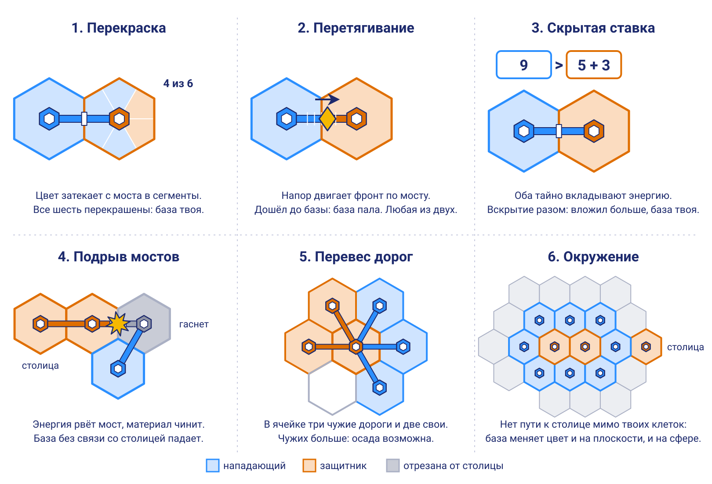

# Как отбирать чужую ячейку

Варианты боя для обсуждения. Это предложение, а не правила. Метки те же, что в [gameplay.md](gameplay.md): **[вы]**, **[эскиз]**, **[гипотеза]**.

Коротко: бой пока не выбран, варианты держим в памяти и развиваем. **[вы]** Ведущий кандидат — перекраска сегментов. Вместе с ней придётся поменять два правила: цена боя должна расти с размером державы, а большинство клеток надо удерживать какое-то время.

Партия идёт в реальном времени **[вы]**, а всё ниже посчитано в раундах. Поэтому числа здесь ориентир. Как перевести правила, разобрано в разделе «Что меняет реальное время».

## Кто воюет, если нет персонажей

Людей и роботов в игре нет. **[вы]** Воевать могут только вещи, которые уже есть на поле: мост, энергия, сегменты и цвет. Поэтому бой в Hexadot — это спор двух сетей за ячейку: цвет одной сети заходит по мосту в ячейку другой. **[гипотеза]**

Бой идёт на глазах: цвет течёт по мосту в ячейку, и база меняет цвет. Отдельный экран боя не нужен. **[гипотеза]**

Сам бой остаётся данными на графе клеток, а картинка только показывает их. Так он одинаково работает в 2D и 3D, как требует [TODO.md](TODO.md). **[вы]**

Осада из `gameplay.md` боем не является. Это ценник: заплатил 6 энергии, и база твоя. Защитник там ничего не решает.

## Шесть вариантов

Бой начинается там, где мост дошёл до чужой базы. Все правила и числа в этом разделе **[гипотеза]**.

### 1. Перекраска сегментов

Шесть сегментов ячейки становятся полоской здоровья.

- **Как идёт.** Приказ «Удар» перекрашивает 2 сегмента цели, начиная от моста. Приказ «Ремонт» возвращает 1. Перекрашенный сегмент не приносит владельцу ресурс. Все сегменты перекрашены, и база меняет цвет.
- **Что решает защитник.** Чинить или бить в ответ по тому же мосту: мост работает в обе стороны.
- **Сильная сторона.** Бой собран из уже нарисованных частей и читается с одного взгляда, даже на сфере. На ответ есть время.
- **Слабая сторона.** Блефа нет: удар виден сразу.

### 2. Перетягивание на мосту

Мост между двумя базами становится канатом.

- **Как идёт.** На середине моста стоит метка фронта. Приказ «Напор» двигает её на шаг, а когда напирают оба, она стоит. Метка дошла до базы, и база пала. Если никто не напирает, метка сама идёт обратно к середине.
- **Что решает защитник.** На каком мосту упираться: база отдаёт один приказ, а мостов к ней может быть несколько.
- **Сильная сторона.** Самые короткие правила и честный риск: нападающий может потерять свою базу.
- **Слабая сторона.** Метка на мосту мелкая для телефона и сферы, а материал в бою не участвует. Столица на сфере падает слишком легко: в 22% партий на 92 клетках и в 67% на 162.

### 3. Скрытая ставка

Бой длиной в одно вскрытие.

- **Как идёт.** Нападающий тайно вкладывает энергию. База держит 5, столица 11, а защитник может тайно добавить щит. Затем суммы открываются разом: вложил больше, и база твоя. Ставка сгорает в любом случае, щит сгорает только в той части, которая пригодилась.
- **Что решает защитник.** Какую из баз под угрозой прикрыть.
- **Сильная сторона.** Блеф и настоящая трата энергии.
- **Слабая сторона.** Много угадывания. В реальном времени ставкам нужен отдельный отсчёт, а вводить суммы на каждую угрозу тяжело.

### 4. Подрыв мостов

Бьют не по базе, а по снабжению.

- **Как идёт.** Дорога дошла до чужой базы, и энергия взрывает один из её мостов. База без связи со столицей гаснет и вскоре падает. Она достаётся тому, чья дорога к ней дошла, иначе становится нейтральной.
- **Что решает защитник.** Строить запасные мосты заранее: новый мост построить не успеть. Материал так становится бронёй.
- **Сильная сторона.** Карта дорог становится главной ценностью, а пара «энергия ломает, материал чинит» получается сама.
- **Слабая сторона.** Столицу так не взять, а один удачный взрыв гасит целую ветку.

### 5. Перевес дорог

Бой без урона: всё решает геометрия.

- **Как идёт.** Осада срабатывает, только если твоих дорог в ячейке больше, чем дорог её владельца. Для столицы нужна ещё одна лишняя.
- **Что решает защитник.** Достроить дорогу от соседней своей базы.
- **Сильная сторона.** Одно предложение правил, и всё видно на карте.
- **Слабая сторона.** Ровный фронт замирает, потому что дорог с обеих сторон поровну.

Этот подход может пригодиться для пятиугольников. Там нет базы, значит перекрашивать нечего, а артефакт достаётся тому, чьих дорог к нему больше. Полос пять, поэтому ничьей не бывает, когда заняты все. **[гипотеза]**

### 6. Окружение

Наследие «Точек».

- **Как идёт.** Приказа нет. База, у которой не осталось пути к своей столице мимо твоих клеток, через какое-то время меняет цвет.
- **Что решает защитник.** Держать проход открытым.
- **Сильная сторона.** Связь с Dottle и названием игры, никаких новых приказов. Сомнение из `gameplay.md` снимается: на сфере отрезанной считается та сторона кольца, где нет столицы. Правило проверено на плоскости и на сфере вручную.
- **Слабая сторона.** Боты не планируют кольца, поэтому ответа, интересно ли это, проверка не даёт.

Окружение не спорит с остальными вариантами: его можно добавить к любому как правило без приказа.

## Проверка ботами

Скрипт [combat_sim.py](combat_sim.py) берёт карту, ботов и раунды из [balance_sim.py](balance_sim.py) и меняет только бой. Партии идут на плоскости из 61 клетки и на сфере из 92 клеток, значения в таблице записаны через дробь. На сфере старт теперь с шестиугольников, а пятиугольники закрыты, как в TODO. По 1000 партий на строку. Всё посчитано в раундах, до решения о реальном времени.

Победа в этой таблице: вражеская столица или больше половины клеток, удержанные 5 раундов подряд. Почему не сразу, сказано ниже. Цена боя растёт с размером державы, кроме первой строки и ставки.

| Вариант | Раундов в партии | Смен владельца | Раундов на бой | Боёв без захвата, % | Партий без развязки, % | План окупается, % |
| --- | --- | --- | --- | --- | --- | --- |
| Осада, цена 6 | 49 / 56 | 38 / 69 | 1 | 0 | 34 / 31 | 44 / 27 |
| Осада, цена растёт | 50 / 58 | 25 / 27 | 1 | 0 | 14 / 10 | 38 / 48 |
| **Перекраска** | 51 / 65 | 16 / 27 | 3 | 23 / 12 | 1 / 4 | 86 / 93 |
| Перетягивание | 50 / 63 | 4 / 10 | 3 / 2 | 49 / 34 | 3 / 4 | 90 / 96 |
| Скрытая ставка | 50 / 61 | 20 / 27 | 1 | 41 / 33 | 1 / 0 | 47 / 40 |
| Подрыв мостов | 45 / 52 | 7 / 10 | 2 | 54 / 49 | 3 / 2 | 43 / 60 |
| Перевес дорог | 44 / 52 | 2 / 4 | 1 | 22 / 9 | 5 / 33 | 49 / 36 |
| Окружение | 43 / 52 | 0 / 0 | нет боя | нет боя | 6 / 49 | 48 / 26 |

- **Смен владельца:** сколько раз за партию база перешла к сопернику, медиана.
- **Боёв без захвата:** доля боёв, которые кончились ничем или не успели закончиться.
- **Партия без развязки:** 30 раундов никто не потерял ни клетки, либо партия упёрлась в лимит 150 раундов.
- **План окупается:** как часто бот, который собирает удары на самых открытых целях и идёт к столице, обыгрывает бота, который бьёт всё, до чего дотянулся. Для ставки число не показательно: оба бота ставят наугад.

## Что показала проверка

1. **Ценник не работает.** С фиксированной ценой клетки перекидываются без конца: 38 / 69 смен владельца за партию, и каждая третья партия не приходит к развязке.
2. **Энергии было с избытком, и в прошлый раз я этого не заметил.** Прежняя проверка смотрела на темп, а не на дефицит. Энергии у бота 24 к 10-му раунду и 45 к 20-му, а к 30-му он получает по 25 за раунд при цене осады 6. Пока энергия почти бесплатна, выгоднее бить всё подряд: в перекраске с фиксированной ценой план выигрывает 37 / 11% партий. Когда цена растёт с размером державы, он выигрывает 86 / 93%, а к концу партии у игрока остаётся 87 / 61 энергии вместо 378 / 504. Шаг роста важен: при шаге в 3 базы план выигрывает 93 / 97%, при шаге в 6 уже 48 / 78%.
3. **Удар должен быть сильнее ремонта.** Когда они равны, один защитник держит один мост: смен владельца 5 / 11 вместо 16 / 27. Когда чинить могут все соседи, война почти исчезает: 3 / 5 смены, а 65 / 63% боёв ничем не кончаются.
4. **Столице нужна помощь.** Если столица чинит себя одна, на сфере она падает в 13% партий на 92 клетках и в 48% на 162, а на большой сфере простой бот обыгрывает планирующего: план выигрывает лишь 35%. Когда её чинят ещё и связанные базы, она падает в 0,3% и 3% партий, а план выигрывает 68%. Обратная сторона: партии почти всегда решает большинство.
5. **Немедленное большинство отменяет войну.** Если половина клеток побеждает сразу, от первого захвата до конца партии проходит 8 / 14 раундов, а смен владельца 5 / 9. С отсчётом в 5 раундов война занимает 19 / 29 раундов и даёт 16 / 27 смен. Отсчёт в 3 раунда даёт 10 / 18 смен, а при 8 раундах партий без развязки уже 5 / 15%.
6. **Без рабочего боя карта делится пополам.** На сфере 33% партий перевеса дорог и 49% партий окружения не приходят к развязке. В выборке из 120 партий на вариант все такие партии кончились равным числом клеток и без единой нейтральной.
7. **Часть правил не нужна.** Кража дохода и самоочистка краски почти ничего не меняют, поэтому их нет в рекомендации. Простой захваченной базы для перекраски тоже не обязателен: без него смен владельца 18 / 24. Я оставил его ради статуса «захваченная» с эскиза. Мост в обе стороны полезен: с односторонними мостами партий без развязки 6 / 6% вместо 1 / 4%.

## Рекомендация

Перекраска. Она даёт настоящий бой из того, что уже нарисовано, вознаграждает план и почти не застывает. Партия занимала 51–65 раундов, на сфере из 162 клеток 90. Если раунд равен 5 секундам, это 4–6 и 7–8 минут.

Ближайшая альтернатива — перетягивание. Боёв там примерно втрое меньше, зато каждый острее. Но столица падает слишком легко, а материал на войне не нужен.

Правила перекраски целиком, пока в раундах:

1. Мост, дошедший до чужой базы, работает в обе стороны: бить могут оба.
2. Удар: приказ базы на конце моста, перекрашивает 2 сегмента цели, платит энергией.
3. Ремонт: приказ базы в этой ячейке, возвращает 1 сегмент, платит материалом. Столицу чинят ещё и базы, связанные с ней мостом, остальным ячейкам соседи не помогают.
4. Сегмент стоит 1 плюс 1 за каждые 4 своих базы.
5. Перекрашенный сегмент не приносит владельцу ресурс и сам не очищается.
6. Все сегменты перекрашены, и база меняет цвет. Сегменты столицы выдерживают вдвое больше.

Энергия бьёт, материал чинит. Это продолжает разделение «материал строит, энергия захватывает», поэтому выбор направления решает ещё и то, кем вы будете на войне: тот, кто пошёл к энергии, нападает, а тот, кто пошёл к материалу, держится.

Пример боя. У синего 8 баз, значит сегмент стоит 3 энергии.

| Раунд | Что произошло | Сегментов синего |
| --- | --- | --- |
| 1 | Синий бьёт: цвет зашёл с моста, добыча в этих сегментах встала | 2 из 6 |
| 2 | Синий бьёт, оранжевый чинит | 3 из 6 |
| 3 | Синий достроил второй мост и бьёт двумя, оранжевый чинит | 6 из 6, база синяя |

Вместе с боем меняются два правила из `gameplay.md`:

- **Победа.** Больше половины клеток надо удержать 5 раундов. В интерфейсе это обратный отсчёт, а у отстающего остаётся шанс отбиться.
- **Цены.** Цена боя растёт с размером державы так же, как цена базы.

## Что меняет реальное время

Правила выше записаны в раундах, и их надо перевести на длительности. **[гипотеза]**

| В раундах | В реальном времени |
| --- | --- |
| Один приказ базы за раунд | База ведёт одну работу, приказ держится, пока его не отменят |
| Удар красит 2 сегмента за раунд | Пока идёт натиск, сегмент перекрашивается раз в несколько секунд |
| Ремонт возвращает 1 сегмент за раунд | Ремонт идёт вдвое медленнее удара |
| Цена удара | Энергия списывается, пока идёт натиск |
| Отсчёт в 5 раундов | Таймер удержания большинства |

Варианты ложатся на это по-разному:

- **Перекраска и перетягивание** подходят лучше всех: это полоски, которые ползут у всех на глазах.
- **Подрыв мостов, перевес дорог и окружение** почти не меняются: в них всё решает состояние сети.
- **Скрытая ставка** подходит хуже всех: ей нужен отдельный отсчёт, который останавливает поток игры.

Появляется новый дефицит: внимание игрока. Боты отдают приказы всем базам разом, а человек не успеет. Проверка этого не видит.

## Что развить

1. Перевести `balance_sim.py` и `combat_sim.py` с раундов на такты и заново проверить варианты.
2. Ограничить бота по вниманию: столько приказов в минуту, сколько успевает человек.
3. Придумать правило для нескольких нападающих: на больших полях базу могут красить двое и больше.
4. Проверить бой в партиях с несколькими ботами.
5. Найти вторую трату материала. Кандидат — укрепления на пустых сегментах.

## Что отброшено сразу

- **Отдельный экран боя или мини-игра.** Ломает реальное время и сеть, а игра становится двумя разными играми.
- **Кубики.** Случайность поверх случайной карты: поражение без своей вины.
- **Башни и снаряды.** Это те же персонажи, только неподвижные.
- **Приказы с поддержкой соседей, как в настольной «Дипломатии».** В черновом прогоне фронт замирал так же, как при перевесе дорог, а приказов больше.

Блеф можно добавить позже, если перекраске его не хватит: скрытые суммы вместо фиксированного удара. В черновом прогоне столица на сфере падала при этом слишком часто, так что числа придётся подбирать.

## Границы проверки

- Играли простые боты, поэтому вопрос «интересно ли» открыт. Ответ даст только живая партия.
- «План окупается» зависит от ботов и карты. На бедной карте (15% на ресурс) и на богатой (35%) бой жив: партий без развязки 1–5%. Но сам показатель плавает от 45 до 94%, так что цену боя придётся подбирать вместе с генератором карты.
- Первый захват случается поздно, около 33-го раунда: если раунд равен 5 секундам, это третья минута. К 20-му раунду материала у бота всего 1–3 единицы. Даже бот, который с первого раунда тянет дороги к столице, в черновом прогоне взял первую базу на 31–35-м раунде и выиграл 55–57% партий. Рывок игру не ломает, но и драку раньше не приносит. Если она нужна раньше, придётся сближать старты или удешевлять дороги.
- Материала к концу партии слишком много: 538 / 1218 на игрока. Укрепления на пустых сегментах забирают заметную часть (остаётся 354 / 461) и не мешают бою, а у пустых сегментов появляется смысл. Это кандидат на следующий шаг.
- Скрытая ставка проверена слабо: её ценность в чтении соперника, а боты ставят наугад.
- Окружение возникало случайно, около 0,4 раза за партию: боты его не планируют.
- Нет тумана, денег и партий на троих и больше.

## Что нужно решить

Какой бой брать, решим, когда варианты будут развиты. Выбранный войдёт в `gameplay.md`, а оттуда в спецификацию.
