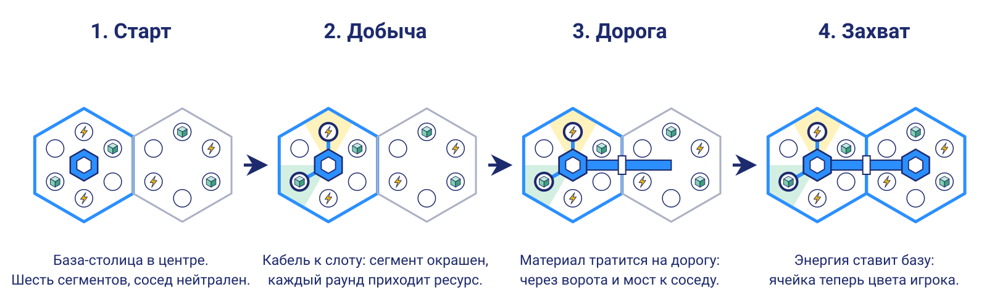

# Предполагаемый геймплей

Это предложение для обсуждения, а не восстановленные правила. Каждое утверждение помечено источником:

- **[вы]** сказано вами;
- **[эскиз]** нарисовано или написано в черновиках;
- **[гипотеза]** моё предложение, закрывающее белое пятно. Его можно менять.

Откуда что взялось, разобрано в [retrospective.md](retrospective.md).

## Суть

Hexadot — стратегия про рост сети на сотах. Игрок начинает с базы в шестиграннике, добывает ресурсы его сегментов и тянет дорогу к соседу. Дорога дошла, в центре соседа появляется база цвета игрока, и всё повторяется. Вся стратегия в выборе направления: куда идти зависит от того, какой ресурс нужен сейчас и что лежит рядом. **[вы]**

Цикл короткий: **добыть → проложить дорогу → поставить базу → выбрать следующее направление**.

Играют от двух человек, а на больших полях до 20–50. Вместо людей могут играть бот и боты. Точные числа подберём на практике. **[вы]**

## Поле

Ячейка устроена так, как показано на [схеме](svg/cell_anatomy.svg): база в центре, шесть слотов ресурсов на лучах к углам и шесть полос дорог на лучах к серединам граней. **[эскиз]**

| Тип ячейки | Что внутри | Что можно | Источник |
| --- | --- | --- | --- |
| Полная | Ресурс во всех шести сегментах | База, добыча | **[эскиз]** |
| Частичная | Ресурс в части сегментов, может быть всего один | База, добыча | **[эскиз]**, **[вы]** |
| Пустая | Ресурсов нет | База, поэтому годится как перевалочный пункт | **[эскиз]**, **[вы]** |
| Void | Ничего | Базу не построить **[эскиз]**, дорогу не провести **[гипотеза]** | **[эскиз]** |

Препятствие (горы, озёра) закрывает несколько позиций подряд: в них нет ресурса и не идёт дорога. **[эскиз]** Полоса на общей грани закрыта для обеих ячеек сразу. **[гипотеза]**

### Случайно, но честно

Ресурсы лежат по сегментам случайно. **[вы]** Чистая случайность плохо сочетается с двумя игроками: на сфере более богатый старт выиграл 63% партий. Поэтому предлагаю три правила. **[гипотеза]**

1. Карта симметрична: случайно строится половина, вторая получается отражением. На плоскости это поворот на 180°, на сфере переход к противоположной точке.
2. В стартовой ячейке всегда есть и энергия, и материал.
3. Столица приносит понемногу каждого ресурса сама по себе. Это страховка: совсем бедный старт не становится тупиком.

Симметрия работает только для двух игроков. На больших полях старты придётся расставлять равномерно и проверять честность отдельно. **[гипотеза]**

## Ресурсы

| Ресурс | Откуда | На что | Источник |
| --- | --- | --- | --- |
| Материал | Сегменты | Дороги и добывающие постройки | **[эскиз]** |
| Энергия | Сегменты (возможно, кристалл) | Постановка базы, осада, улучшения | Источник **[эскиз]**, траты **[гипотеза]** |
| Деньги | Пока неясно | Пока неясно | Есть на эскизе, в первой версии не участвуют **[гипотеза]** |
| Ничего | Пустой сегмент | Серая зона | **[эскиз]** |

Разделение простое: **материал строит, энергия захватывает**. Из-за него направление и становится выбором. Сосед с материалом ускорит дороги, сосед с энергией ускорит захваты, а пустая клетка может быть единственным проходом к богатой.

## Время

Партия идёт в реальном времени. **[вы]**

Логика считается тактами, а картинка между ними только дорисовывает движение. Так правила остаются на графе клеток, не зависят от 2D или 3D и одинаково работают на сервере, у бота и в тестах. **[гипотеза]**

1. **Доход.** Каждая постройка приносит свой ресурс по таймеру, столица приносит понемногу каждого.
2. **Приказы.** Игрок отдаёт их в любой момент. База ведёт одну работу за раз, а приказ держится, пока его не отменят: иначе двадцать баз руками не удержать.
3. **Выполнение.** Работа занимает время: дорога строится, добыча подключается, база ставится.

Больше баз значит больше работ сразу, это естественный рост. **[гипотеза]**

Длительности ещё надо подобрать. Отправная точка — личный таймер Dottle в 5 секунд. Раунд в проверке ботами ближе всего к одной работе базы, поэтому партия из 40–65 раундов заняла бы 3–6 минут. **[гипотеза]**

Цены ниже тоже отправная точка: энергии в них слишком много, это разобрано в [combat.md](combat.md). **[гипотеза]**

| Приказ | Что делает | Цена |
| --- | --- | --- |
| Добыча | Ставит постройку на слот своей ячейки и подключает её кабелем | 2 материала |
| Дорога | Продвигает дорогу на этап: от ворот до грани, затем мостом до центра соседа | 2 материала за этап |
| База | Ставит базу в конце готовой дороги | Энергия: 2 + число своих баз |
| Осада | Заглушка: отбирает чужую базу в конце готовой дороги. Варианты настоящего боя в [combat.md](combat.md) | 6 энергии, столица 12 |

На старте у игрока 6 материала и 3 энергии. Цена базы растёт с размером державы, поэтому сильному лидеру расширяться дороже.

Если две дороги приходят в нейтральную клетку в один такт, она достаётся меньшей державе, а при равенстве решает жребий. Проигравшему энергия возвращается. **[гипотеза]**

## База

| Статус | Откуда | Что значит |
| --- | --- | --- |
| Столица | Старт | Приносит доход сама по себе. Потеря означает поражение **[гипотеза]** |
| Освоенная | Поставлена в нейтральной клетке | Работает полностью |
| Захваченная | Отбита у соперника | Какое-то время не добывает и не принимает приказов, затем становится освоенной **[гипотеза]** |

Названия статусов взяты с эскиза, а их смысл предложен мной. Вражеские дороги к взятой базе разрушаются, поэтому отбить её сразу нельзя. Это правило удержания: без него база переходит из рук в руки в два-три раза чаще.

Цвет игрока получают база и дороги, а цвет зоны показывает ресурс. **[эскиз]**

## Победа

Побеждает тот, кто взял вражескую столицу или держит больше половины доступных клеток. **[гипотеза]** Порог важен: с порогом в две трети боты не смогли закончить 99% партий. Большинство лучше удерживать какое-то время: немедленная победа почти отменяет войну, это разобрано в [combat.md](combat.md). **[гипотеза]**

На полях для 20–50 игроков половину клеток никто не наберёт, поэтому условие победы для них ещё надо придумать.

## Радар и туман войны

Это второй этап. Улучшение базы открывает кольца соседей: первая ступень видит первое кольцо, вторая второе. Другой вариант с эскиза — туман войны разной прозрачности. **[эскиз]**

Варианты удобно совместить. **[гипотеза]** Без радара сосед виден как контур, первая ступень показывает, есть ли в нём ресурсы, вторая показывает какие. Тогда разведка влияет именно на выбор направления.

## Плоскость и планета

Правила одинаковы, потому что им нужен только граф клеток. **[гипотеза]** У обычной ячейки шесть сегментов и шесть полос, а на краю плоской карты часть полос просто никуда не ведёт. Бот отыграл партии на обеих топологиях одним кодом.

На сфере всегда ровно 12 пятиугольников, размер задаёт частота разбиения n:

| n | Клеток | Шестиугольников | Для чего подходит |
| --- | --- | --- | --- |
| 2 | 42 | 30 | Быстрая партия |
| 3 | 92 | 80 | Дуэль, около 47 раундов |
| 4 | 162 | 150 | Длинная дуэль, около 72 раундов, или больше игроков |
| 5 | 252 | 240 | Большая партия |
| 8 | 642 | 630 | Около 20 игроков |
| 12 | 1442 | 1430 | Около 50 игроков |

Две последние строки считают примерно по 30 клеток на игрока, как в дуэли на плоскости. **[гипотеза]**

Пятиугольник — не обычная ячейка с базой. В нём пустота или глобальный артефакт, энергетический или мифический, который даёт свои преференции. **[вы]** Поэтому старт идёт только с шестиугольников. Двум игрокам подходят противоположные, без соседей-пятиугольников: симметрия карты получается сама. **[гипотеза]** Расстановку для трёх и более игроков ещё нужно придумать.

## Платформы

Цель — все платформы. **[вы]** Godot экспортирует на Windows, macOS, Linux, Android, iOS и Web. Реальное время и 20–50 игроков потребуют сервера, который считает партию, поэтому ядро правил должно запускаться без графики. **[гипотеза]**

Управление стоит сразу сделать единым: нажатие выбирает, перетаскивание двигает карту или вращает планету, щипок или колесо меняют масштаб. Экран следует эскизу: ресурсы вверху, карта справа внизу. **[эскиз]**

## Первый играбельный срез

Цель — понять, интересно ли решать, куда идти. Всё остальное откладывается. **[гипотеза]**

В срез входят плоское поле на 61 клетку, человек против бота **[вы]**, энергия и материал, все четыре приказа и условие победы. Не входят планета, туман, деньги и сеть.

Порядок работы:

1. Ядро правил без графики, с тестами, на графе клеток, со счётом по тактам.
2. Бот. Он же проверяет правила и потом становится соперником.
3. Плоский экран с HUD. На этом шаге появляется первая настоящая партия.
4. Несколько ботов на одном поле: правила для трёх и более игроков проверятся ещё до сети.
5. Радар и туман.
6. Деньги, если для них найдётся роль.
7. Планета на 92 клетки: новый вид для уже работающих правил.
8. Игра по сети, затем большие поля.

## Проверка на ботах

Всё в этом разделе посчитано в раундах, до решения о реальном времени. Темп и баланс придётся перепроверить на тактах.

Правила прогнаны скриптом [balance_sim.py](balance_sim.py): по 1000 партий на строку, бот против такого же бота. Отклонения в районе ±3 процентных пунктов для долей около половины — это шум.

В прогоне сегмент содержал энергию или материал с вероятностью 25% каждый, препятствие было в 25% ячеек, `void` составлял 8%. В стартовой ячейке лежали 2 энергии, 2 материала и 2 пустых сегмента.

| Что мерили | Вариант | Плоскость, 61 | Сфера, 92 | Сфера, 162 |
| --- | --- | --- | --- | --- |
| Длина партии, раундов | Предложенные правила | 38 | 47 | 72 |
| Первый захват, раунд | Предложенные правила | 7 | 7 | 7 |
| Победы первого игрока, % | Ходы по очереди | 62,6 | 58,9 | 52,3 |
| | По очереди, открывающий меняется | 50,0 | 49,4 | 52,1 |
| | Одновременно | 47,6 | 50,4 | 48,8 |
| Смен владельца за партию | Без удержания | 32 | 77 | нет данных |
| | С удержанием | 11 | 34 | 87 |
| Партии, упёршиеся в лимит 150 раундов, % | Порог 1/2 | 0,6 | 0 | 0 |
| | Порог 2/3 | 99,7 | 99,3 | нет данных |
| Игроки без захвата к 30-му раунду, % | Случайный старт, без страховки | 10,7 | 14,4 | нет данных |
| | Случайный старт, со страховкой | 0 | 0 | нет данных |
| Победы более богатого старта, % | Случайный старт, со страховкой | 52,5 | 63,3 | нет данных |

Что это значит:

- Партия занимает 38–72 раунда. Сколько это в минутах, зависит от длительности работы базы.
- Преимущество первого хода настоящее, если ходить строго по очереди на полях до 92 клеток. Его снимают и смена открывающего, и одновременные раунды.
- Страховка столицы убирает тупики, а симметрия убирает зависимость от удачного старта.

Границы проверки:

- Играли два одинаковых простых бота, поэтому игра «интересно ли» не проверена. На этот вопрос ответит только живая партия.
- Почти все партии кончились большинством: при удержании столица падала не чаще чем в 1% партий. Война поэтому проверена слабо.
- Проверялся темп, а не дефицит. Позже выяснилось, что энергии у ботов с избытком, поэтому цены надо пересмотреть, это разобрано в [combat.md](combat.md).
- Нет тумана, денег и партий на троих и больше.

## Что решено

1. **Время.** Реальное. **[вы]**
2. **Первый режим.** Человек против бота, дальше партии против нескольких ботов. **[вы]**
3. **Игроки.** От двух, на больших полях до 20–50. Точные числа подберём на практике. **[вы]**

## Что нужно решить

1. **Конфликт.** Бой не выбран: варианты держим в памяти и развиваем. **[вы]** Осада из таблицы приказов — заглушка. Шесть вариантов и их проверка разобраны в [combat.md](combat.md), ведущий кандидат там перекраска.
2. **Победа на больших полях.** Варианты: последняя столица, наибольшая доля поля к концу таймера или две большие команды, как 10 000 против 8 900 на экране Dottle.
3. **Деньги.** Нужен ответ, зачем они. Варианты: третий добываемый ресурс или доход от связанных дорогами баз, тогда у дорог появляется второй смысл. Значка денег в сегментах на эскизах нет, поэтому мне ближе второй.
4. **Void.** Предлагаю считать его непроходимым, и тогда он работает как рельеф карты.
5. **Пятиугольники.** Пустота или артефакт. **[вы]** Если артефакт, нужно решить, что он даёт и как им завладеть. Один из вариантов предложен в [combat.md](combat.md).

Из прежней версии этого файла убраны «умения»: их нет ни на эскизах, ни в вашем описании.
