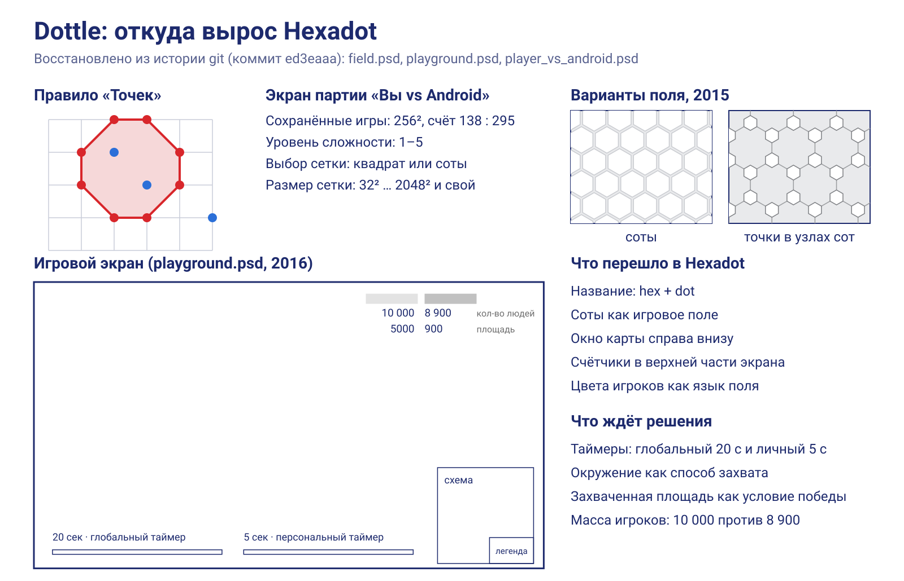
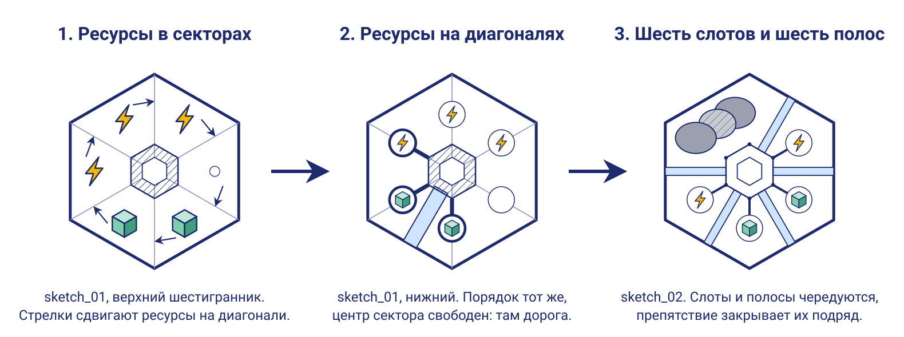
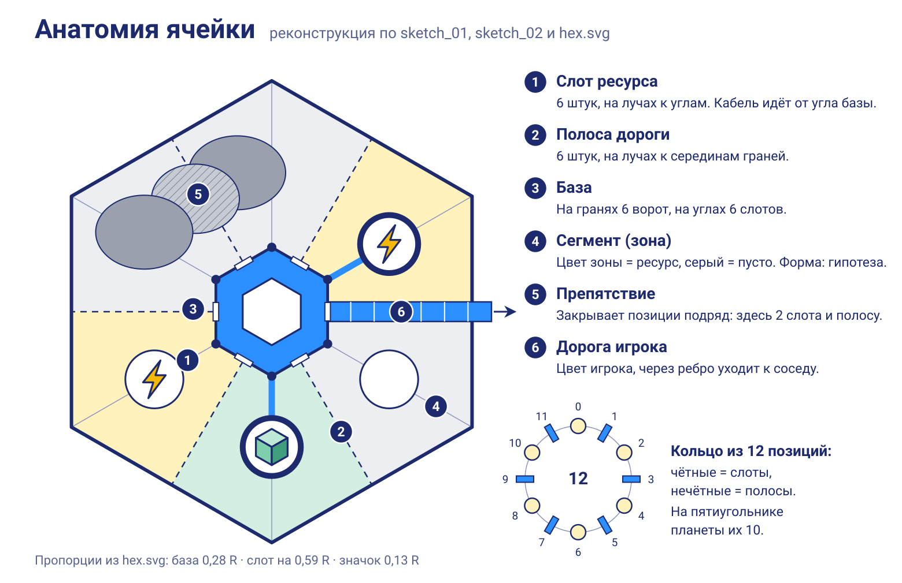

# Ретроспектива Hexadot

Разбор всего, что есть по проекту: папка `.drafts/`, 68 коммитов истории git за 2021–2026 годы и файлы, удалённые из рабочей копии. Старый код запускался в Godot 4.8 beta2 на временной копии, поэтому в репозитории он не менялся.

Предполагаемый геймплей вынесен в [gameplay.md](gameplay.md), здесь разобрано прошлое и сделаны выводы.

## Главное

- **Идее больше десяти лет.** Hexadot вырос из Dottle, цифровой версии игры «Точки» 2015 года. Название буквально складывается из hex и dot.
- **Дизайн ячейки проработан лучше, чем казалось.** Из эскизов собирается точная модель: 6 слотов ресурсов на лучах к углам и 6 полос дорог на лучах к серединам граней.
- **Кода с правилами нет совсем.** Из 539 строк GDScript 306 занимает икосаэдр, а слов «ход», «игрок», «захват» в коде нет.
- **Прототип сломан одной причиной.** Все 13 ошибок запуска идут от регистра имён папок. После трёх переименований на копии их ноль.
- **Цикл игры жизнеспособен.** Боты по предложенным правилам доигрывают партии на плоскости и на сфере за 38–72 раунда без тупиков.
- **Главный урок.** Работа началась с самой сложной и необязательной части, сферы, и до правил так и не дошла.

## Что есть в черновиках

| Файл | Что это | Что сделано |
| --- | --- | --- |
| `sketch_01.jpg`, `sketch_01b.jpg` | Одна и та же страница тетради, 480×600 и 3024×4032 | [svg/sketch_01.svg](svg/sketch_01.svg) |
| `sketch_02.jpg` | Вторая страница, самая подробная | [svg/sketch_02.svg](svg/sketch_02.svg) |
| `hex.svg` | Концепт ячейки 2022 года из Inkscape | Уже вектор. Его пропорции взяты за эталон для всех схем |
| `icosahedron_index.png` | Развёртка икосаэдра с нумерацией | [svg/icosahedron_net.svg](svg/icosahedron_net.svg) |
| `icosahedron.svg` | Картинка в base64 и слои нумерации v1–v5 | Оставлен как есть: это история поиска нумерации |
| `gameplay.md` | Прежняя гипотеза ИИ | Переписан |
| `TODO.md` | Идея про начальный шестигранник | Не менялся. Пункт учтён в геймплее, но спецификации ещё нет, поэтому остаётся открытым |
| `references.md` | Пустой шаблон | Не менялся |

Новые файлы, которых не было на бумаге:

| Файл | Что показывает |
| --- | --- |
| [svg/cell_anatomy.svg](svg/cell_anatomy.svg) | Реконструкция ячейки с подписями |
| [svg/cell_evolution.svg](svg/cell_evolution.svg) | Как ячейка менялась от эскиза к эскизу |
| [svg/gameplay_loop.svg](svg/gameplay_loop.svg) | Раскадровка цикла: старт, добыча, дорога, захват |
| [svg/dottle_legacy.svg](svg/dottle_legacy.svg) | Сводка по Dottle из истории git |
| `svg/icons/` | Иконки энергии, материала, денег, пустоты и дороги. Читаются SVG-загрузчиком Godot |
| [balance_sim.py](balance_sim.py) | Проверка предложенных правил ботами, числа подставляются прямо в нём |

Подписи перенесены с эскизов по-русски, орфография выровнена («освоеная» → «освоенная», «кристал» → «кристалл»). Косые подписи второго листа поставлены горизонтально. У всех листов есть слои Inkscape.

## Хронология

| Когда | Что произошло | Откуда известно |
| --- | --- | --- |
| 2015-10 | Поле Dottle: соты и точки в узлах сот | `field.psd` |
| 2016-02 | Экран Dottle: два таймера, счёт людей и площади, карта с легендой | `playground.psd` |
| 2021-02 | Макет мобильного экрана «Вы vs Android» | `player_vs_android_*.psd` |
| 2021-11 | Создан репозиторий Hexadot | `fdb494c` |
| 2022-01 | 3D-эксперименты: камера, модель машины, ходьба по планете | `4450115`, `db0cad2`, `480f794` |
| 2022-01…02 | Икосаэдр и подписи вершин: 31 коммит за две недели | `b61e44b` … `0a8e5d6` |
| 2022-06 | В репозиторий добавлен арт Dottle | `ed3eaaa` |
| 2022-08 | Концепт ячейки `hex.svg` | `edcca24` |
| 2023-08 | Переезд на Godot 4, арт Dottle удалён, появился `HexResource` | `51e7b17`, `dccee9c` |
| 2024-02 | Единственная правка за год: версия 4.1 → 4.2 | `7ed2df6` |
| 2026-11 | Реанимация: инфраструктура и новые фото эскизов | `53e827d`, `6987099` |

Из 68 коммитов 56 пришлись на январь и февраль 2022 года. За следующие почти четыре года их было восемь.

Удалённые файлы можно вернуть из истории, например `git archive ed3eaaa stuff | tar -x`.

## Что рассказали наброски

### Родословная: «Точки» → Dottle → Hexadot

Dottle был мобильной версией игры «Точки»: игроки ставят точки на сетку и окружают точки соперника. В примерах лежат картинки этой игры (`Gra_w_kropki`, польское название). Макет уже содержал выбор сетки «квадрат» или «соты», пять уровней бота и размеры поля до 2048².

Экран `playground` показывает смелую версию: счётчики людей 10 000 против 8 900 и два таймера, глобальный на 20 секунд и личный на 5. Похоже, задумывалось сражение двух больших команд, где общий таймер задаёт раунд, а личный ограничивает частоту ходов. Это моё прочтение, подписей с объяснением нет.

В Hexadot перешло окно карты справа внизу (HUD на первом эскизе повторяет компоновку `playground`), счётчики вверху и идея цвета игрока. Таймеры, окружение и площадь как условие победы остались неиспользованным наследием.

### Ячейка: шесть плюс шесть

Самая ценная находка. Сначала ресурсы стояли в центрах треугольных секторов. На верхнем шестиграннике `sketch_01` у каждого ресурса есть маленькая стрелка, и все шесть идут по часовой и упираются в ближайшую диагональ. Нижний шестигранник показывает результат: тот же порядок ⚡ ⚡ ○ ■ ■ ⚡, но уже на диагоналях. Центры секторов освободились, и туда легла дорога.

`sketch_02` доводит это до системы, и всё сходится:

| Деталь | Где видно | Что значит |
| --- | --- | --- |
| Ресурс стоит на луче к углу | Нижний шестигранник `sketch_01`, большой в `sketch_02`, `hex.svg` | Шесть слотов ресурсов |
| Дорога идёт к середине грани | Там же | Шесть полос, по одной на соседа |
| Кабель выходит из угла базы | `sketch_01`, `sketch_02` | Слот находится на углу |
| Ворота на грани, слот на ребре | Рисунок базы в `sketch_02` | База симметрична ячейке |
| Препятствие закрывает 2 ресурса и дорогу между ними | Большой шестигранник `sketch_02` | Запреты идут по соседним позициям |

Получается кольцо из 12 чередующихся позиций, удобное и для данных, и для рисования. Форма сегмента (зона между двумя дорогами) на эскизах прямо не показана, это мой вывод из легенды окрашивания.

### Цвет несёт два разных смысла

Легенда «Окрашивание» разделяет владение и экономику. Цвет игрока получают база и дороги, а цвет зоны говорит о ресурсе: энергия, материал или нейтральный серый. Поэтому поле читается сразу на двух уровнях.

### Статусы базы и типы клеток

База бывает столицей, освоенной и захваченной. Различие «освоенная» и «захваченная» говорит о том, что чужую базу можно отобрать и что она какое-то время отличается от своей.

Клетка бывает полной, частичной, пустой и `void`. Пустая всё равно принимает базу, а на `void` нельзя построить даже её.

### Чего в набросках нет

| Вопрос | Что известно |
| --- | --- |
| Зачем нужна энергия | Нигде не сказано. В коде строка обрывается там же: `description = "Energy - "` |
| Откуда и зачем деньги | На первом листе стоит «?», на втором уже без вопроса, но в сегментах значка денег нет, как нет и зоны денег |
| Как захватить чужую базу | Есть только статус «захваченная» |
| Условие победы | Нет |
| Ходы или реальное время | Нет. Таймеры Dottle и «полоска прогресса» в `resource.gd` намекают на время |
| Цены и числа | Нет |
| Можно ли провести дорогу через `void` | Сказано лишь, что базу не построить |

Список использования ресурса начат только для материала: дороги и добывающие постройки. Похоже, работа остановилась именно на этом месте.

## Состояние кода

Всё ниже проверено запуском на копии, а не только чтением кода.

| Что нашлось | Доказательство | Насколько важно |
| --- | --- | --- |
| Пути `res://src/world/…` не совпадают с папками `app/src/World/…` | 13 ошибок и 19 предупреждений при запуске, сцена не работает. Godot предупреждает, что на чувствительных к регистру платформах файл не откроется | Критично для «всех платформ». Лечится переименованием `World`, `Resources`, `Planet` в нижний регистр: на копии 0 ошибок и 0 предупреждений |
| Икосаэдр неправильный: широта 60° вместо atan 2 ≈ 63,43° | Рёбра 1,00, 1,02 и 1,13 вместо равных 1,05, разброс 13,4% | Клетки на сфере вышли бы разного размера |
| Грани и вершины в разных нумерациях | `init_faces()` работает в старой зигзаг-нумерации, остальное в кольцевой: 20 из 20 граней не сходятся, со старой схемой сходятся все | Незаметно, потому что грани никто не рисует |
| Таблицы в `dataset` скопированы | Все четыре таблицы одинаковы, размер 12×5, хотя таблицы граней должны быть 20×3. Используется одна | Мёртвый код |
| `HexResource` нельзя повесить на `Node` | `Script inherits from native type 'RefCounted'`: `energy.tscn` остаётся без скрипта | Ресурсы не работают |
| `planet.gd` не подключён к сцене | 360 клеток по экватору дали бы около 51 842 клеток | Неверный масштаб |
| Камера отладочная | Полёт и захват мыши, действия создаются на лету, а `movement_*` из настроек не используются | На сенсорный экран не переносится |
| Инфраструктуры проверок нет | `app/tests` и `app/addons` отсутствуют, GUT запустить нельзя. `gdformat` переформатировал бы 6 файлов из 10, `gdlint` нашёл 49 проблем | Обязательные проверки проекта пока не выполнить |
| Настройки устарели | В `project.godot` указана версия 4.2, метод рендеринга не задан | Для Web и мобильных нужен осознанный выбор |

Что написано верно: таблица соседей вершин симметрична и даёт ровно 30 рёбер, а формула `SurfaceClass` для числа вершин правильная.

## Что получилось и что нет

**Получилось:**

- Ячейка. Шесть слотов и шесть полос, база с воротами и слотами, препятствия по соседним позициям: это законченная и красивая модель.
- Рисование как способ думать. Эскизы точнее кода, а стрелки на первом листе сохранили ход мысли спустя годы.
- Разделение смыслов цвета: владение отдельно, экономика отдельно.
- Понимание, что сферу нужно строить от икосаэдра, а поиск нумерации в слоях v1–v5 был системным.

**Не получилось:**

- Порядок работы. Сфера необязательна для проверки идеи, но ушла на неё почти вся энергия.
- Масштаб. 360 клеток по экватору и поле 2048² несовместимы с ячейкой, в которой живут база, шесть слотов и шесть дорог.
- Правила так и не были записаны, поэтому каждый возврат к проекту начинался заново.
- Обратная связь. Ни разу не было состояния, в которое можно поиграть.
- Память проекта. Сообщения вроде `vertex` и `Fix` мало что объясняют, а связь с Dottle исчезла вместе с арт-файлами в коммите `Revert to version 4`.
- Побочные ветки: машина и ходьба по планете не связаны со стратегией на клетках.

Почему проект заглох, можно только предполагать. Моя версия такая: математика сферы не давала видимого результата, а без него не было момента, ради которого хочется вернуться.

## Выводы

1. **Ценность проекта сейчас в модели ячейки, а не в коде.** Старый код можно почти целиком переписать без потерь.
2. **Сфера это вид на граф, а не другая игра.** Правилам нужен только граф клеток, где у клетки сколько-то соседей. Это проверено: один и тот же код симуляции отыграл партии и на плоскости, и на сфере с пятиугольниками.
3. **Двенадцать пятиугольников неизбежны, и это ресурс.** Сферу нельзя замостить одними шестиугольниками: на ней всегда ровно 12 пятиугольников. Они симметричны между собой, поэтому годятся как честные точки старта.
4. **Масштаб игры в десятках и сотнях клеток.** Партии хватает 61 клетки на плоскости и 92 на сфере.
5. **Двигаться надо снизу вверх:** правила, бот, плоский экран, радар и только потом сфера.
6. **Белые пятна важнее кода.** Роль энергии и денег, захват и победа определяют игру сильнее любой геометрии. Предложения по ним есть в [gameplay.md](gameplay.md).
7. **Наследие Dottle стоит пересмотреть.** Глобальный таймер подсказывает модель времени, а окружение может стать фирменным приёмом и оправдать вторую половину названия.

## Что оставить, что переписать

| Что | Решение | Почему |
| --- | --- | --- |
| Эскизы, `hex.svg`, пропорции ячейки | Оставить | Основа дизайна |
| Таблица соседей `dataset.vertex.vertices` | Оставить | Проверена, пригодится для сферы |
| Формулы `SurfaceClass` | Оставить как идею | Верны, но дают только 12, 42, 162, 642 клетки. Для 92 и 252 нужна частота разбиения, а не степень четвёрки |
| `icosahedron.gd` | Переписать | Неверная широта, две нумерации, мёртвые таблицы |
| `resource.gd` и наследники | Переписать | Ресурс это данные, а не узел сцены. Заодно уйдёт опечатка `matherial` |
| `planet.gd` | Убрать | Не подключён, а геометрия от экватора здесь не нужна |
| `camera.gd`, `action.gd` | Убрать | Отладочная камера под мышь |
| `vertex_ball`, `label` | Оставить на время | Удобная отладка нумерации на сфере |
| Имена папок | Исправить первым делом | Без этого проект не запускается и не экспортируется |
